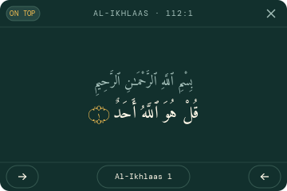

# win-quran

A native Qur'an reader widget for Windows. A small, frameless ayah card that sits on the desktop,
reads with the arrow keys, and needs no browser, no webview and no background runtime.

The Qur'an text is Tanzil Uthmani, bundled into the executable and verified by SHA-256 before anything
is drawn.



## Using it

Run `win-quran.exe`. With no arguments it is the widget.

| What | How |
|---|---|
| Move one ayah forward | left arrow, or `j` |
| Move one ayah back | right arrow, or `k` |
| Open the sura list | click the sura name in the bottom bar |
| Jump to a sura | open the list, scroll with the wheel, click the row |
| Leave the list | the back arrow at the top left, or `Esc` |
| Keep above other windows | the `ON TOP` button at the top left, `t`, or a right click |
| Pin it to the desktop instead | press it again: the card drops below every window and stays on the desktop layer |
| Scroll a long ayah | mouse wheel, two lines per notch |
| Move the card | drag its top bar |
| Close | the `x` at the top right, or `Esc` when no list is open |

The card does not take keyboard focus until you click it, so it never steals typing from whatever you
are doing. Click it once to give it the arrow keys.

Running the executable again raises the card that is already open instead of starting a second one.

`Esc` closes the topmost layer: the sura list first, and the widget only once nothing is above it.

### At startup

To start with Windows, run this once from the folder holding the executable:

```
win-quran.exe autostart on
```

and `win-quran.exe autostart off` to remove it. It writes a single per-user value under
`HKCU\Software\Microsoft\Windows\CurrentVersion\Run` and needs no administrator rights. The value
records the full path of the executable, so if the file is moved, run `off` and then `on` from the new
location.

## Where it keeps things

Nothing is installed and nothing is written next to the executable. Two small JSON files live in
`%APPDATA%\win-quran`:

| File | Contents |
|---|---|
| `state.json` | the reading position, for example `{"surah": 18, "ayah": 10, "updated_at": "..."}` |
| `settings.json` | window position and the always-on-top choice |

Both are created on first use. Deleting them resets the widget to Al-Faatiha 1:1 and to the default
position in the top right corner.

## Building

```
cargo build --release      # target/release/win-quran.exe
cargo test                 # unit, data integrity and shaping
```

The executable is standalone: the text, the metadata and all three fonts are embedded at compile
time, so there is nothing to install and nothing to ship beside it. The icon is embedded too:
`build.rs` compiles `win-quran.rc` with the Windows SDK's `rc.exe` and links the result. A machine
without the SDK still builds, with a warning and without an icon.

| Command | Purpose |
|---|---|
| `win-quran` or `win-quran run` | show the widget |
| `win-quran autostart on\|off` | add or remove the startup entry |
| `win-quran info` | summarise the bundled mushaf |
| `win-quran verify` | every data integrity check, for humans |
| `win-quran shaping` | shape the whole mushaf and report what the font produced |
| `win-quran marker` | how the ayah end marker shapes and where its ink lands |
| `win-quran icon [--out PATH]` | draw the application icon as PNG and ICO |
| `win-quran dump [--surah N] [--aya N] [--light] [--list] [--scroll N] [--out PATH]` | render the card to a PNG |

`dump` is how the drawing is inspected without a window: it runs the same layout and the same
rasterizer the widget uses and writes the pixels to a file.

## Data

The Qur'an text, the metadata and the Amiri Quran font come from Tanzil and are carried verbatim.
Nothing is fetched from an API, normalized, trimmed or rewritten, because Tanzil's licence forbids
changing the text.

| Asset | SHA-256 | Pinned by |
|---|---|---|
| `assets/quran-uthmani.txt` | `6933e133...39ec5f` | Tanzil |
| the upstream `quran-data.js` used to generate the sura table | `9e9930c5...bac4ca4` | Tanzil |
| `assets/fonts/AmiriQuran.woff2` | `2c01d1cc...f27128` | Tanzil |
| `assets/fonts/Manrope.woff2` | `06ad9fd9...0ea687b` | this project |
| `assets/fonts/DMMono-Regular.woff2` | `3d687db9...38e58d2c` | this project |

The text file must keep LF line endings. A CRLF checkout changes its SHA-256 and leaves a trailing byte
on every line, so `.gitattributes` pins the endings and a test asserts the embedded text contains no
carriage return.

The Qur'an is 114 suras and 6,236 ayat. The bundled text and the bundled metadata are independent
Tanzil artefacts, so their agreement is checked rather than assumed: every sura's ayah count is
compared between the two.

### Regenerating the sura table

`src/metadata_generated.rs` is generated from Tanzil's `quran-data.js`, which is JavaScript rather than
JSON and is therefore evaluated in a sandbox instead of parsed. The generated file is committed, so
builds do not need the source; only regeneration does.

```
node scripts/convert-quran-data.mjs --data-dir <path to the directory holding quran-data.js>
node scripts/convert-quran-data.mjs --check     # every pin, and the generated file is current
```

Without `--data-dir` the script reads `WIN_QURAN_DATA_DIR`. A copy only counts once its SHA-256
matches the pin, so it does not matter where the file came from. Node is a build-time tool here and
uses only built-in modules.

## Shaping

Uthmani text cannot be drawn glyph by glyph. Letters take contextual forms, harakat attach to their
base, and some codepoints merge, so the text goes through rustybuzz, a port of HarfBuzz, before
anything is positioned. The pinned Amiri Quran font is decompressed from its WOFF2 form at startup.

`cargo run -- shaping` walks the whole mushaf and reports, as measured on this tree:

- 714,313 codepoints become 706,555 glyphs, with **zero** glyphs missing from the font
- a letter takes three different joined forms plus a fourth isolated form
- a joined pair never falls back to the isolated forms
- 3,900 of 6,236 ayat merge codepoints through substitutions
- 292,568 glyphs are placed by attachment rather than by their own advance
- 29,076 places carry two marks on one base

Two facts worth knowing. The ayah end marker (U+06DD) appears in none of the text, because it is
generated for display. And Amiri Quran draws U+06DD followed by digits as a ring with the number
*beside* it: measured, the ring's ink and the digits' ink do not overlap, and no OpenType feature
changes that. This widget deliberately deviates there and draws the number inside the ring itself,
which `cargo run -- marker` can be used to inspect.

## Current limits

- The card is a fixed height. At 22px it shows about three and a half ayah lines, and a longer ayah
  scrolls by wheel; a height that follows the ayah is planned but not built.
- No tray icon, so closing is the `x` or `Esc`.
- No search. The sura list is browsed by scrolling.

## Licenses

The code in this repository has no license declared yet; that is an open decision.

Bundled third-party material keeps its own terms: the Qur'an text and the metadata are copyright
Tanzil Project, licensed CC BY 3.0 (`assets/LICENSE-TANZIL.md`), and the three fonts are licensed under
the SIL Open Font License 1.1 (`assets/fonts/OFL-*.txt`).
